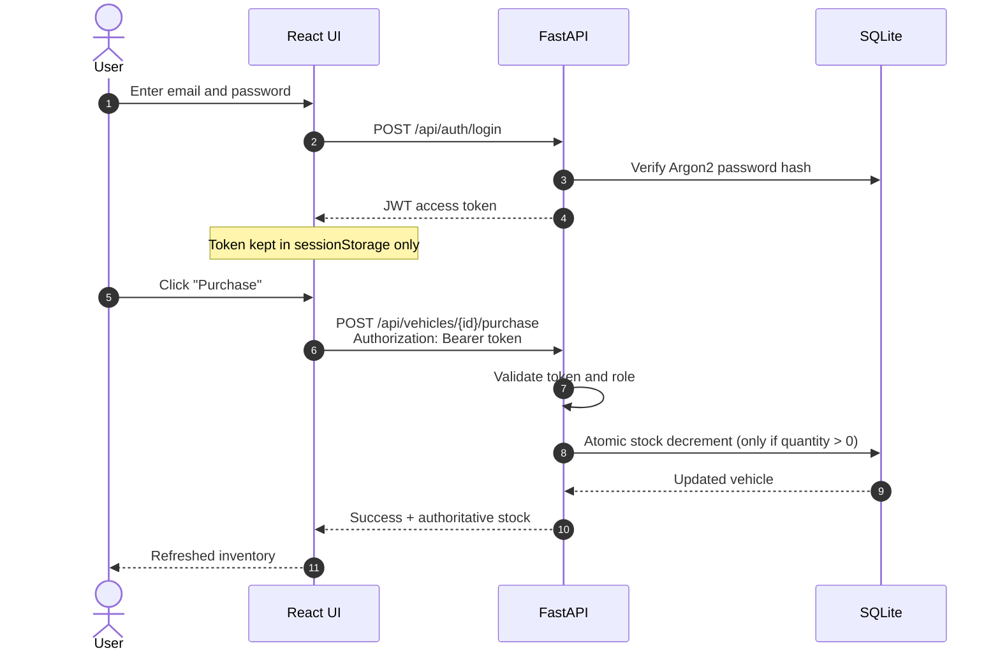
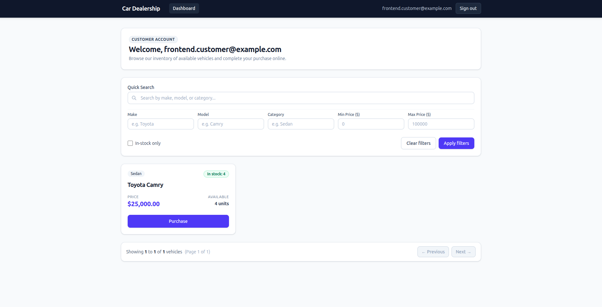
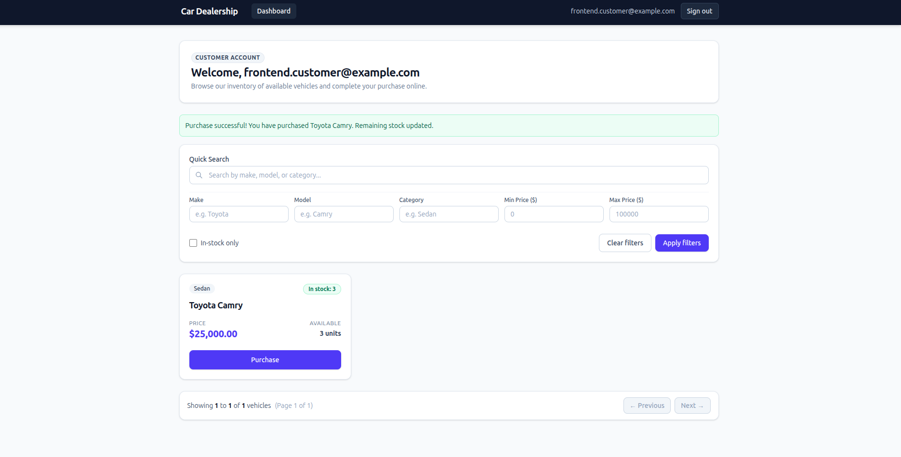
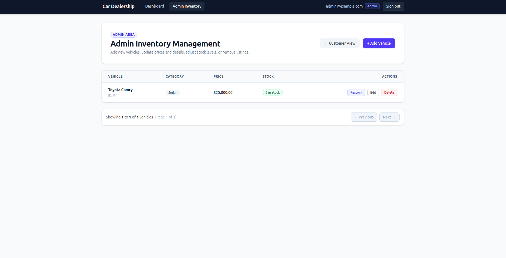
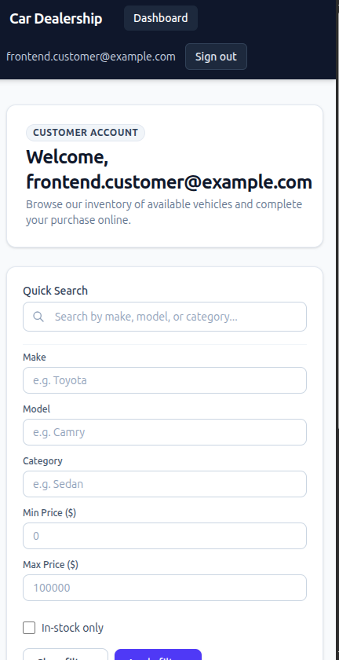

<div align="center">



<br />

**A full-stack vehicle inventory platform for customers and dealership administrators.**
Browse, filter, purchase, restock, and manage vehicles through a fast, responsive web interface.

<br />


<br />


<br /><br />

[**Quick Start**](#-quick-start) &nbsp;•&nbsp;
[**Features**](#-features) &nbsp;•&nbsp;
[**Architecture**](#-architecture) &nbsp;•&nbsp;
[**Step-by-Step Setup**](#-step-by-step-setup) &nbsp;•&nbsp;
[**Screenshots**](#-screenshots) &nbsp;•&nbsp;
[**API**](#-api-reference) &nbsp;•&nbsp;
[**Security**](#-security)

</div>


## ⚡ Quick Start

Already have **Git**, **Python 3.11+**, and **Node.js 20+**? You can be running in about two minutes. You need **two terminals**: one for the backend, one for the frontend.

<table>
<tr>
<td width="50%" valign="top">

**🖥️ Terminal 1: Backend**

```bash
git clone https://github.com/anikethpowar/car-dealership-inventory-system.git
cd car-dealership-inventory-system

python3 -m venv venv
source venv/bin/activate

cd backend
python -m pip install -r requirements.txt
cp .env.example .env
python -m alembic upgrade head
python -m scripts.seed_admin
uvicorn app.main:app --reload
```

</td>
<td width="50%" valign="top">

**🌐 Terminal 2: Frontend**

```bash
cd car-dealership-inventory-system/frontend

npm ci
cp .env.example .env
npm run dev
```

Then open **http://localhost:5173** and sign in:

| | |
|---|---|
| **Email** | `admin@example.com` |
| **Password** | `AdminPass123!` |

</td>
</tr>
</table>

> [!NOTE]
> Need more detail, Windows commands, or help with an error? Jump to the [**Step-by-Step Setup**](#-step-by-step-setup) and [**Troubleshooting**](#-troubleshooting).


## ✨ Features

<table>
<tr>
<td width="50%" valign="top">

### 🛒 For Customers

- 🔐 Create an account and sign in securely
- 🚘 Browse vehicles with price and stock status
- 🔎 Search by make, model, or category
- 🎛️ Filter by make, model, category, price, and stock
- 💳 Purchase one vehicle unit at a time
- ⚡ See stock refresh immediately after every action

</td>
<td width="50%" valign="top">

### 🛠️ For Administrators

- 🔒 Sign in to a protected admin workspace
- ➕ Add new vehicles to the inventory
- ✏️ Edit vehicle details
- 📦 Restock units
- 🗑️ Delete vehicles
- 🧩 Same secure API as the customer app

</td>
</tr>
</table>

> [!IMPORTANT]
> **The backend is the source of truth for every permission and stock update.** Hiding an admin button in the UI never grants access, because the API enforces role checks on every request.


## 🧭 Architecture

<div align="center">

</div>

### 🔁 The sign-in and purchase flow




## 🛠 Tech Stack

| Area | Tools |
|:--|:--|
| ⚙️ **Backend** |     |
| 🔐 **Security** | -000000?logo=jsonwebtokens&logoColor=white&style=flat-square) -7c3aed?style=flat-square) |
| 🗄️ **Database** |  |
| 🎨 **Frontend** |      |
| ✅ **Quality** |    |

<details>
<summary><b>📁 Project structure</b></summary>
<br />

```text
car-dealership-inventory-system/
├── backend/                 # FastAPI application, migrations, tests, seed script
│   ├── app/                 # Routes, models, schemas, services, security
│   ├── alembic/             # Database migrations
│   ├── scripts/             # Dev helpers, including seed_admin.py
│   └── tests/               # Auth, role, inventory, and purchase tests
├── frontend/                # React + Vite + Tailwind single-page application
│   └── src/                 # API client, auth state, pages, reusable components
├── docs/                    # Test evidence, screenshots, and README assets
├── PROMPTS.md               # Raw AI prompt evidence
└── README.md                # You are here
```

</details>


## 🚀 Step-by-Step Setup

### 1️⃣ Requirements

Install these once. Each row shows how to check that it's already on your machine.

| Tool | Recommended | Minimum | Check with | Download |
|:--|:--|:--|:--|:--|
| **Git** | Latest | any recent | `git --version` | [git-scm.com](https://git-scm.com/downloads) |
| **Python** | 3.12 | 3.11 | `python3 --version` | [python.org](https://www.python.org/downloads/) |
| **Node.js** | 22 | 20 | `node --version` | [nodejs.org](https://nodejs.org/) |
| **npm** | 10+ | 10 | `npm --version` | *(comes with Node.js)* |

> [!TIP]
> **Two terminals, always.** The frontend alone can't register or log in users. It needs the FastAPI backend running at the same time. Keep both windows open while you use the app.

---

### 2️⃣ Get the code

```bash
git clone https://github.com/anikethpowar/car-dealership-inventory-system.git
cd car-dealership-inventory-system
```

---

### 3️⃣ Start the backend 🖥️ *(Terminal 1)*

**a) Create and activate a virtual environment** from the project root:

<details open>
<summary><b>🐧 Linux / 🍎 macOS</b></summary>

```bash
python3 -m venv venv
source venv/bin/activate
```

</details>

<details>
<summary><b>🪟 Windows (PowerShell)</b></summary>

```powershell
python -m venv venv
venv\Scripts\Activate.ps1
```

</details>

Your prompt should now start with `(venv)`.

**b) Install the backend packages:**

```bash
cd backend
python -m pip install -r requirements.txt
```

**c) Create your local config and database tables:**

```bash
cp .env.example .env              # Windows: copy .env.example .env
python -m alembic upgrade head
```

**d) Create the demo administrator:**

```bash
python -m scripts.seed_admin
```

**e) Start the API and leave this terminal running:**

```bash
uvicorn app.main:app --reload
```

✅ **You should see** the server start on `http://127.0.0.1:8000`. Open [`/api/health`](http://127.0.0.1:8000/api/health) in a browser to confirm it's alive.

---

### 4️⃣ Start the frontend 🌐 *(Terminal 2)*

Open a **new** terminal window. From the repository root:

```bash
cd frontend
npm ci
cp .env.example .env              # Windows: copy .env.example .env
npm run dev
```

✅ **You should see** Vite print a local address, normally **http://localhost:5173**. Open it.

---

### 5️⃣ Sign in and explore 🎉

| Field | Value |
|:--|:--|
| 📧 **Email** | `admin@example.com` |
| 🔑 **Password** | `AdminPass123!` |

Or click **Register** to create a regular customer account.

> [!WARNING]
> These are intentionally public **development-only** credentials. Never use default credentials in a production deployment. Customer accounts cannot become administrators through the browser.

---

### 🔗 Useful local links

| Resource | Link |
|:--|:--|
| 🎨 React application | http://localhost:5173 |
| 💚 API health check | http://127.0.0.1:8000/api/health |
| 📘 Interactive API docs (Swagger) | http://127.0.0.1:8000/docs |
| 📕 Alternative API docs (ReDoc) | http://127.0.0.1:8000/redoc |


## 🧪 Verify the Project

Run these after making changes, or before submitting.

<table>
<tr>
<td width="50%" valign="top">

**Backend**

```bash
cd backend
python -m pytest tests -q
python -m ruff check app tests scripts
python -m alembic current
```

</td>
<td width="50%" valign="top">

**Frontend**

```bash
cd frontend
npm run lint
npm run build
```

</td>
</tr>
</table>

**Current verified result:** ✅ 28 backend tests passing · ✅ Ruff clean · ✅ ESLint clean · ✅ Vite production build succeeds.

For the full manual checklist, results, and known third-party warnings, see [`docs/TESTING.md`](docs/TESTING.md).


## 📸 Screenshots

<div align="center">




<sub><b>Customer experience:</b> browsing, search and filter controls, and an authoritative stock refresh after purchase.</sub>

<br /><br />



<sub><b>Admin workspace:</b> add, edit, restock, and delete actions.</sub>

<br /><br />



<sub><b>Responsive by design:</b> the customer dashboard at mobile width.</sub>

</div>


## 🔌 API Reference

Full interactive docs are available at [`/docs`](http://127.0.0.1:8000/docs) once the backend is running.

<details>
<summary><b>🔐 Authentication and account routes</b></summary>
<br />

| Method | Route | Access | Purpose |
|:--:|:--|:--:|:--|
|  | `/api/health` | 🌍 Public | Check server and database connectivity |
|  | `/api/auth/register` | 🌍 Public | Register a customer account |
|  | `/api/auth/login` | 🌍 Public | Receive a JWT access token |
|  | `/api/auth/me` | 👤 Signed in | View current user profile and role |
|  | `/api/admin/me` | 🛡️ Admin | Verify administrator access |

</details>

<details>
<summary><b>🚘 Vehicle inventory routes</b></summary>
<br />

| Method | Route | Access | Purpose |
|:--:|:--|:--:|:--|
|  | `/api/vehicles` | 🌍 Public | List vehicles, filters, and pagination |
|  | `/api/vehicles/search` | 🌍 Public | Search make, model, or category |
|  | `/api/vehicles/{vehicle_id}` | 🌍 Public | View one vehicle |
|  | `/api/vehicles` | 🛡️ Admin | Add a vehicle |
|  | `/api/vehicles/{vehicle_id}` | 🛡️ Admin | Update a vehicle |
|  | `/api/vehicles/{vehicle_id}` | 🛡️ Admin | Delete a vehicle |
|  | `/api/vehicles/{vehicle_id}/purchase` | 👤 Signed in | Purchase one unit safely |
|  | `/api/vehicles/{vehicle_id}/restock` | 🛡️ Admin | Increase stock |

</details>


## 🔐 Security

<table>
<tr>
<td width="33%" valign="top">

### 🔑 Credentials
Passwords are hashed with **Argon2** via `pwdlib`. Plain-text passwords are never stored.

</td>
<td width="33%" valign="top">

### 🎟️ Tokens
**JWTs expire** and are signed server-side with HS256. The frontend uses `sessionStorage`, not `localStorage`, so sessions end with the tab.

</td>
<td width="33%" valign="top">

### 🛡️ Permissions
**Backend permissions win.** FastAPI dependencies validate the current user and admin role on every protected operation.

</td>
</tr>
<tr>
<td width="33%" valign="top">

### ⚛️ Atomic purchases
Stock is decremented **only when `quantity > 0`**, preventing negative inventory under concurrent requests.

</td>
<td colspan="2" valign="top">

### 🙈 Local-only files stay local
The SQLite database, `.env` files, virtual environments, `node_modules`, and build output are all ignored by Git.

</td>
</tr>
</table>


## 🧯 Troubleshooting

| Problem | Fix |
|:--|:--|
| 🌐 Registration or login fails from the website | Confirm **both** terminals are running: FastAPI on port **8000** and Vite on port **5173**. |
| ❓ `node: command not found` | Install or activate Node.js, then check `node --version` and `npm --version`. |
| 🗄️ Database or table error | From `backend/`, run `python -m alembic upgrade head`. |
| 🔑 Admin login doesn't work | From `backend/`, run `python -m scripts.seed_admin`, then use the documented demo account. |
| 🚧 Port already in use | Stop the older server with `Ctrl + C`, then start the command again. |
| 🐍 `(venv)` missing from the prompt | Re-run the activation command from [step 3a](#3%EF%B8%8F%E2%83%A3-start-the-backend-%EF%B8%8F-terminal-1). |

## 📦 Deployment Status

> This project is configured for **local demonstration**. There is no verified public deployment URL yet.

## 🤖 AI Usage and Transparency

AI assistance was used openly during this project:

- **ChatGPT** helped with planning, architecture guidance, Git workflow guidance, QA planning, and documentation guidance.
- **Google Antigravity in VS Code** helped generate and refine implementation code from scoped prompts.
- **The developer** reviewed all generated work, ran tests and builds locally, completed browser testing, captured screenshots, made deliberate decisions, and committed and pushed the work.

The unedited prompt record is available in [`PROMPTS.md`](PROMPTS.md). AI-assisted commits include an attribution trailer where applicable.

## 📄 License

See [`LICENSE`](LICENSE).

<div align="center">
<br />

<br /><br />
<sub>Built with FastAPI, React, and a lot of careful testing. ⭐ Star the repo if you found it useful.</sub>
</div>